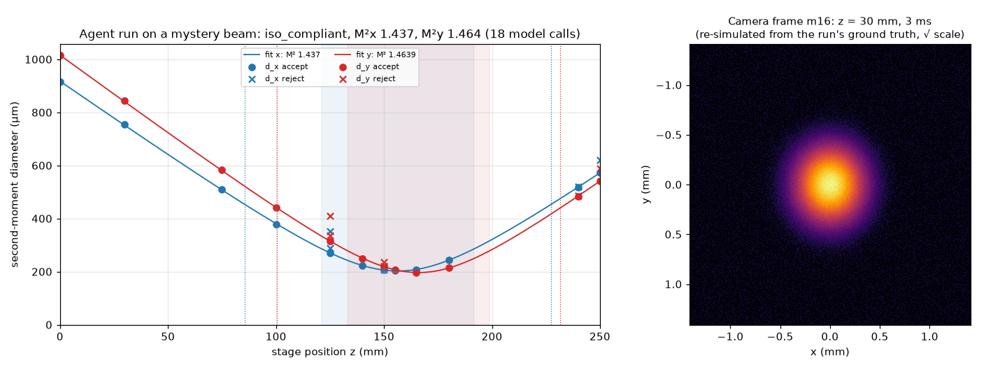

# BeamPilot

An AI agent that measures a laser beam's M² to ISO 11146 on a simulated camera and
stage, and says honestly when the standard cannot be met.



*A real agent run on a "mystery beam" (`docs/runs/mystery_s7.json`). Left: measured
second-moment diameters per axis (dots accepted, crosses rejected as saturated) with
the fitted caustics. Right: the camera frame at one far-field position. It is
re-simulated from the run's ground truth, because saved runs keep no frames. Made by
`scripts/make_hero_figure.py`.*

## What BeamPilot does

The agent works like an engineer at an M² bench. It chooses stage positions and
exposures, judges each measurement from its quality flags, and accepts or rejects it.
It refits the caustic and places the next points until ISO 11146-1 coverage is met
on both axes: 5 positions within one Rayleigh length and 5 beyond two. Then it gives
a verdict with a short explanation: `iso_compliant`, `estimate_not_compliant`,
`waist_not_accessible`, `general_astigmatism_out_of_scope` or `measurement_failed`.

It works only through 7 tools: `get_setup`, `measure_at`, `set_status`, `evaluate`,
`retake_darks`, `view_frame` and `finish`, plus an optional eighth, `change_lens`,
behind a switch (see "Inaccessible waist" below). All physics is done in Python: ISO
second-moment widths with the iterated 3·d integration area, and a weighted caustic
fit. The report numbers come from session state, never from the model's text. The
controller enforces hard limits on positions, model calls, tokens and cost. Design:
[docs/agent-design.md](docs/agent-design.md).

## Meta models used

- **Muse Spark (`muse-spark-1.2`)** is the agent, through the Meta Model API's
  OpenAI-compatible **Responses API**:
  - **function calling** with strict JSON schemas for the 7 tools, with parallel
    tool calls executed in order like a real stage;
  - **stateless turns**: the history is resent with the encrypted reasoning
    replayed;
  - **image input**: `view_frame` returns a camera frame as a PNG `input_image`
    inside the tool output, so the agent can see what the second moments hide, such
    as a ghost reflection.
- **SAM 3.1** was planned for beam segmentation but is **not used** in this version.

## Quick start

Requires Python 3.10 or newer. The commands below are for Windows PowerShell; on
other systems use `.venv/bin/python` instead of `.venv\Scripts\python.exe`.

```
python -m venv .venv
.venv\Scripts\python.exe -m pip install -e ".[demo]"
.venv\Scripts\python.exe -m beampilot.app
```

Open http://localhost:7860.
- **Replay** plays the saved runs in `docs/runs/` step by step. It needs no API key
  and makes no API calls.
- **Live runs** need a Meta Model API key: copy `.env.example` to `.env` and set
  `MODEL_API_KEY` there. `.env` is git-ignored.
- Both show the caustic plot, the latest camera frame, a live ISO coverage counter
  per axis (5 near and 5 far) and the decision log. After a run they show a results
  card (verdict, M² ± σ per axis, positions, cost); **Reveal truth** then shows the
  measured values against the hidden true ones, with the error.
- **Public hosting:** set `BEAMPILOT_TOKEN_CAP` (tokens per server process; the
  default, 60,000,000, is about $20 at the token mix of our runs). When the cap is
  reached, live runs stop and the page says so; replay keeps working.

Without the demo, the scripted baseline runs a scenario with no API key at all:

```
.venv\Scripts\python.exe -m pip install -e ".[dev]"
.venv\Scripts\python.exe scripts\run_baseline.py clean scripted_iso
```

## Results

Two pre-registered evaluations, v1 and v2 (62 agent runs, $4.93 in total), compared
the agent with a fixed-rule scripted operator. Each case ran twice in total, so small
differences are noise. Full tables: [docs/evaluation-summary.md](docs/evaluation-summary.md).
- **Known scenarios and mystery beams:** a tie, as expected. The agent got 31 of 32
  verdicts right, scripted 30 of 32. The median M² error was about 0.2 %.
- **Plain-language operator notes** ("don't go above 230 mm"): the agent broke none
  in 10 runs; the scripted baseline, which cannot read notes by design, broke them
  16 times.
- **Faults (ghost, hot pixel, drift, iris):** both got 5 of 8 right. The agent's two
  main failures are a ghost it saw in the frame but kept, and an iris it never
  looked at.
- **v2 changes:** raising the call limit and asking for parallel tool calls removed
  all runs stopped by the limit, and cut model calls per run by about a quarter.

## Inaccessible waist: artificial waist with change_lens

When the beam waist lies outside the stage, the agent can insert one thin lens
before the stage with the optional tool `change_lens(f_mm, lens_z_mm)`, forming an
artificial waist inside the stage.
- **Before the lens:** Python lists lens options (a small kit of +25, +40, +300,
  +750 and −200 mm on a rail at −300…−20 mm), scored from the caustic fit only,
  never from the hidden truth.
- **After the lens:** the agent measures the new beam to the ISO 11146-1 rules.
- **Report:** M², unchanged by an ideal lens, and the original waist (d0, z0, zR),
  calculated back through the inverse thin-lens matrix, with its uncertainty and
  its sensitivity to the focal length.

This is reported as **"ISO 11146-1 procedure applied at an artificial waist
(thin-lens model)"**. The parts of ISO 11146-1 on artificial waists have not been
checked against the official text.

**Switch:** off by default (`AgentConfig(change_lens=False)`; the "Lens kit"
checkbox in the demo). Off, the agent's tools and prompt are byte-identical to
before.

**Simplifications:**
- a thin, paraxial, aberration-free lens;
- exact focal length and position, centred and not tilted;
- no clipping at the lens aperture;
- no reflections from the lens;
- the embedded-Gaussian beam model;
- the same spherical lens for x and y.

If a real lens is 1 % longer than its nominal focal length, the reported z0 is off
by minus the listed 'per +1 % f' value.

**Evaluation v3** (pre-registered, 8 waist-outside beams, one run each, $0.97):
- **Agent:** 8 of 8 verdicts right, including one honest `waist_not_accessible`
  where no kit lens could help. In all 7 lens cases M², the back-calculated d0 and
  z0 were within tolerance (3 %, 5 % and 0.1 zR; mostly well under 1 %).
- **Scripted operator:** with a fixed lens rule it did the same; the naive scan got
  1 of 8.
- **Caveats:** the cases were not held out, and two of them are close to the edge
  of what the kit can do. Details:
  [docs/evaluation-results-v3.md](docs/evaluation-results-v3.md).

## How it's tested

- **359 pytest tests**, including physics known-answer tests:
  - an analytic Gaussian gives the right second moments, and a noiseless simulated
    caustic gives back the true M² (including M² = 1);
  - an M² fit on 2 % noise is unbiased;
  - near-waist-only sampling inflates the uncertainty;
  - a ghost's widths match the two-spot mixture moments;
  - an iris matches the truncated-Gaussian moments;
  - a thin lens matches the textbook focus formula (Self 1983), keeps M², and
    forward then inverse returns the original beam;
  - background offsets are removed without clipping negative pixels.
- The agent loop is tested with a fake client, without API calls. The evaluation
  summary and the hero figure are checked against their generators.
- **CI** (GitHub Actions) runs ruff and pytest on Python 3.10 and 3.12, plus a job
  that builds the demo interface.

## Limitations

- **Simulation only.** All beams and camera frames are simulated; nothing has been
  validated on lab data.
- **Embedded-Gaussian beam model.** M² > 1 is a Gaussian with an enlarged width,
  not a real multimode profile.
- **ISO text sources.** The ISO 11146-1:2005 and ISO/TR 11146-3 rules were taken
  from third-party copies of the texts, and the wording of the 2021 edition is
  unverified. Check the key rules against the official standard before relying on
  "ISO compliant".
- **Small evaluation.** One run per case per evaluation, on a single model and
  setting.
- **Artificial waist (change_lens).** The lens is modelled as an exact thin lens.
  If a real lens is 1 % longer than its nominal focal length, the reported z0 is off
  by minus the listed 'per +1 % f' value.

## Hackathon provenance

Built from 26 October to 4 November 2026 for the Meta Global AI Developer Hackathon.
All code was written during the hackathon; there is no prior work, and the commit
history shows the progress. Developed with Claude Code as a coding assistant under
the author's direction and review.

## Licence

MIT
